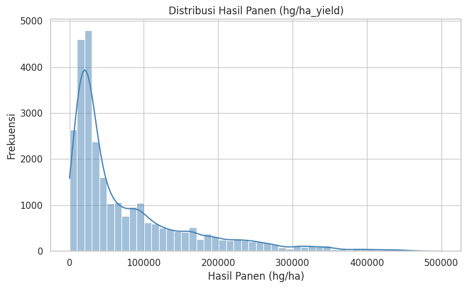
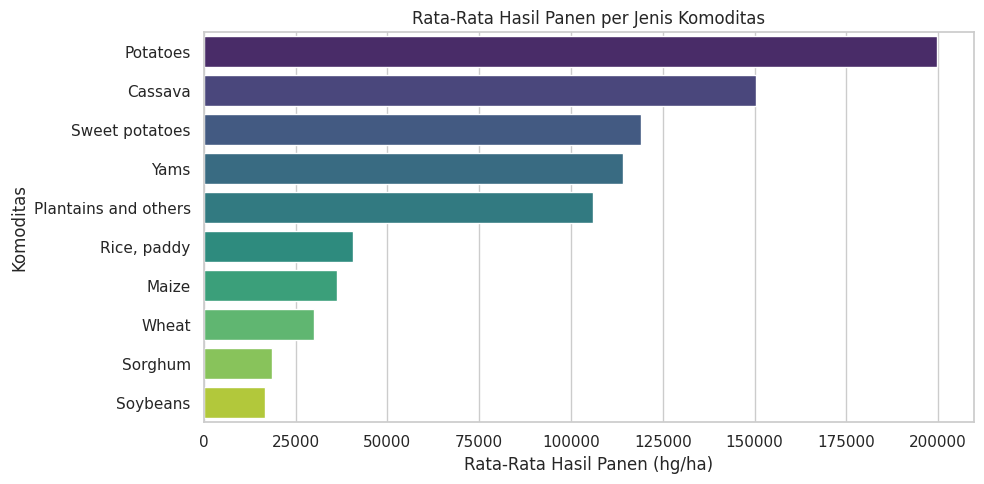
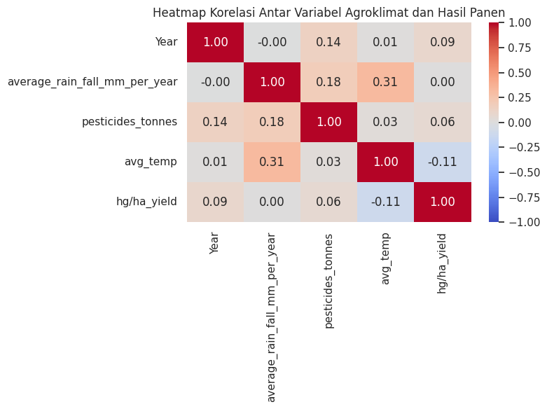
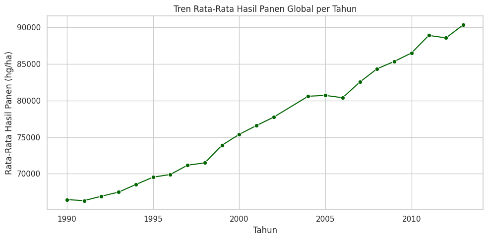
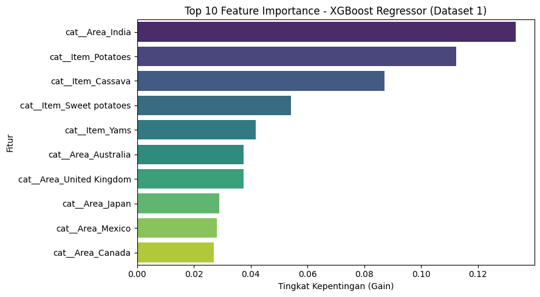
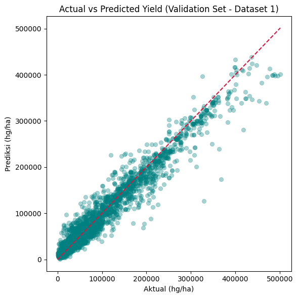

## INFORMASI PROYEK

- **Judul Proyek:**  Fusi Data Penginderaan Jauh dan Parameter Cuaca In Situ untuk Prediksi Kerentanan Pangan Terhadap Anomali Iklim
- **Nama Mahasiswa:** Dheandra Khairunnisa Pambudi & Dzakwan Daris Fakhruddin
- **NIM:** 244311009 & 244311011
- **Program Studi:** Teknologi Rekayasa Perangkat Lunak
- **Mata Kuliah:** Data Science
- **Dosen Pengampu:** Gus Nanang Syaifuddiin, S.Kom., M.Kom.
- **Tahun Akademik:** 2026, Semester 5
- **Link GitHub Repository:** (https://github.com/DheandraKhairunnisaP/DataScience-ProjectUAS.git)
- **Link Video Pembahasan:** [URL Video (YouTube/Drive)]
- **SDG yang Dipilih:** Goal 2 Zero Hunger dengan , didukung oleh Goal 13 Climate Action
- **Target SDG yang Relevan:** Target 2.4 (Pertanian Berkelanjutan) dan Target 13.1 (Ketahanan terhadap Dampak Perubahan Iklim).

---

## 0. KERANGKA ML LIFECYCLE (L-M-O-P)

Laporan ini disusun mengikuti **ML Lifecycle** yang terdiri dari empat tahap berulang (iteratif):

| Tahap | Singkatan | Inti Pertanyaan | Bagian Laporan |
|-------|-----------|-----------------|----------------|
| **Learning Problem** | **L** | Apa target, objective, dan datanya? | Bab 2, 3, 4, 5 |
| **Model Design** | **M** | Model family/arsitektur apa, hypothesis space, dan inductive bias/asumsi apa? | Bab 6 (6.x.1 – 6.x.3) |
| **Optimization** | **O** | Bagaimana model dilatih: loss, optimizer, tuning, regularisasi, konvergensi? | Bab 6 (6.x.4 – 6.x.6) |
| **Predict & Evaluate** | **P** | Seberapa baik prediksi model berdasarkan metrik evaluasi? | Bab 7 |

```
   L (Learning Problem) ──► M (Model Design) ──► O (Optimization) ──► P (Predict & Evaluate)
          ▲                                                                   │
          └─────────────── iterasi / perbaikan berdasarkan hasil evaluasi ────┘
```

**Catatan untuk mahasiswa:** Setiap bagian diberi label **[L]**, **[M]**, **[O]**, atau **[P]**. Pastikan Anda dapat menjelaskan keterkaitan antar tahap, misalnya bagaimana hasil **P** mendorong perbaikan pada **L/M/O** (Bab 7.5).

---

## 1. LEARNING OUTCOMES
Pada proyek ini, mahasiswa diharapkan dapat:
1. **[L]** Mengidentifikasi masalah nyata dari **ide sendiri** yang selaras dengan salah satu tujuan **SDGs** ([Agenda 2030 – sdgs.un.org/2030agenda](https://sdgs.un.org/2030agenda)), lalu merumuskan problem statement (target, objective, data) secara jelas
2. **[L]** Melakukan analisis dan eksplorasi data (EDA) secara komprehensif (**OPSIONAL**)
3. **[L]** Melakukan data preparation yang sesuai dengan karakteristik dataset
4. **[M]** Merancang tiga model machine learning dengan justifikasi hypothesis space dan inductive bias (**WAJIB**):
   - Model baseline
   - Model machine learning / advanced
   - Model deep learning (**WAJIB**)
5. **[O]** Mengoptimasi model secara sistematis (loss function, optimizer, hyperparameter tuning, regularisasi)
6. **[P]** Menggunakan metrik evaluasi yang relevan dengan jenis tugas ML dan menganalisis hasilnya
7. Melaporkan hasil eksperimen secara ilmiah dan sistematis
8. Mengunggah seluruh kode proyek ke GitHub (**WAJIB**)
9. Menerapkan prinsip software engineering dalam pengembangan proyek

---

## 2. PROJECT OVERVIEW  **[L]**

### 2.1 Latar Belakang
Perubahan iklim global memicu ketidakpastian pola cuaca, peningkatan frekuensi kekeringan ekstrem, dan pergeseran jendela musim tanam yang berdampak langsung pada produktivitas sektor pertanian. Ketidakstabilan ini menyebabkan penurunan hasil panen komoditas pangan pokok secara tidak terduga, memicu inflasi harga pangan, dan mengancam stabilitas rantai pasok global. Selama ini, estimasi hasil panen konvensional kerap bergantung pada pelaporan manual setelah masa panen berakhir, sehingga tindakan mitigasi seperti penyesuaian irigasi dan alokasi cadangan pangan terlambat dilakukan. 

Pemanfaatan pembelajaran mesin memungkinkan integrasi data historis agroklimat untuk mengenali pola hubungan non linear antara fluktuasi cuaca, asupan agronomis, dan tingkat hasil panen. Penelitian literatur terdahulu telah membuktikan efektivitas pendekatan komputasi ini. Khaki dan Wang (2019) menunjukkan bahwa pemodelan berbasis neural network mampu menangkap interaksi kompleks lingkungan tanaman dengan akurasi tinggi. Selain itu, kajian sistematis oleh Van Klompenburg et al. (2020) mengonfirmasi bahwa algoritma ensemble pohon keputusan dan deep learning secara konsisten mengungguli regresi linear sederhana pada prediksi produktivitas lahan. Oleh karena itu, proyek ini berfokus pada pembangunan sistem estimasi hasil panen untuk menyediakan proyeksi berbasis data bagi perencana kebijakan dan petani sebelum masa panen usai.

### 2.2 Keterkaitan dengan SDGs (WAJIB)

Ide proyek **berasal dari mahasiswa** dan harus selaras dengan **salah satu** dari 17 Sustainable Development Goals.

| Komponen | Pertanyaan Panduan | Jawaban Anda |
|---|---|---|
| **SDG yang dipilih** | Goal nomor berapa dan apa namanya? | SDG 2 – Tanpa Kelaparan (Zero Hunger) |
| **Target SDG** | Target (misal 3.4, 13.1) mana yang paling relevan? | Target 2.4 – Menjamin sistem produksi pangan yang berkelanjutan dan menerapkan praktik pertanian tangguh yang mampu meningkatkan produktivitas serta adaptif terhadap perubahan iklim dan cuaca ekstrem |
| **Masalah nyata** | Masalah konkret apa yang diangkat? Siapa yang terdampak? | Tingginya risiko gagal panen akibat cuaca ekstrem dan anomali musim yang tidak menentu. Pihak terdampak meliputi petani kecil yang rentan kehilangan pendapatan serta masyarakat luas akibat lonjakan harga pangan pokok. |
| **Peran ML** | Mengapa ML/DL cocok? Apa keputusan atau proses yang dibantu? | ML/DL mampu memetakan interaksi multi-fitur non-linear yang kompleks antara suhu, curah hujan tahunan, dan penggunaan input kimia terhadap yield panen, membantu pembuat kebijakan dan petani memproyeksikan stok pangan lebih awal. |
| **Indikator kontribusi** | Bagaimana hasil model berkontribusi pada target SDG (langsung/tidak langsung)? | Berkontribusi tidak langsung dalam meminimalkan kerugian logistik pangan dan mendukung perencanaan intervensi irigasi adaptif sebelum terjadi krisis pangan lokal. |
| **Pertimbangan etika** | Risiko bias, privasi, atau dampak salah prediksi? | Risiko bias geografis karena data makro didominasi wilayah dengan infrastruktur stasiun cuaca lengkap. Salah prediksi (overestimate) berisiko menyebabkan kekurangan alokasi bantuan cadangan pangan. Data bersifat statistik agregat publik sehingga tidak melanggar privasi individu. |

**Sumber ide:** Pengamatan langsung terhadap fenomena kemarau berkepanjangan dan anomali musim hujan di wilayah sentra pertanian Jawa Timur yang mengakibatkan fluktuasi hasil panen padi dan jagung serta kesulitan petani lokal dalam menentukan waktu tanam optimal.

### 2.3 Ringkasan Alur Lifecycle Proyek
Proyek ini mengimplementasikan siklus L-M-O-P secara bertahap, dimulai dari tahap Learning Problem melalui perumusan target regresi hasil panen (hg/ha) serta kurasi dataset agroklimat FAOSTAT. Pada tahap Model Design, dirancang tiga model dengan variasi kapasitas yaitu Linear Regression, Random Forest Regressor, dan Multilayer Perceptron. Tahap Optimization memfokuskan pelatihan model melalui penyesuaian fungsi loss MSE, tuning hyperparameter berbasis validasi, serta penerapan regularisasi Dropout untuk mereduksi overfitting pada neural network. Pada tahap Predict and Evaluate, evaluasi akhir dilakukan pada test set independen menggunakan metrik RMSE, MAE, dan R-squared, yang hasilnya menjadi dasar iterasi umpan balik untuk rekayasa fitur dan penyempurnaan kapasitas arsitektur model.

---

## 3. BUSINESS UNDERSTANDING / PROBLEM UNDERSTANDING  **[L]**

### 3.1 Problem Statements
1. Bagaimana merancang model machine learning yang mampu memetakan hubungan antara faktor agroklimat (curah hujan, suhu) dan input pertanian dengan tingkat akurasi prediksi hasil panen yang andal?
2. Bagaimana mengatasi kompleksitas dan sifat non linear data iklim pertanian agar model tidak mengalami bias atau kesalahan prediksi yang tinggi?
3. Bagaimana membandingkan performa pendekatan baseline linear, ensemble pohon keputusan, dan deep learning untuk menentukan representasi arsitektur terbaik dalam tugas estimasi produktivitas panen?

### 3.2 Formulasi Learning Problem (WAJIB)

Rumuskan masalah dalam kerangka *Learning Problem*:

| Komponen | Pertanyaan Panduan | Jawaban Anda |
|---|---|---|
| **Target** | Apa yang diprediksi? Jenis tugas (klasifikasi biner/multikelas, regresi, forecasting, clustering, dll.)? | Jenis tugas: Regresi (Supervised Learning). Variabel target: Estimasi produktivitas hasil panen tanaman pangan (hg/ha_yield) dalam satuan hektogram per hektar (hg/ha). |
| **Objective** | Apa yang dioptimalkan/diminimalkan secara matematis (misal: cross-entropy, MSE)? Metrik keberhasilan utama? | Objective: Meminimalkan fungsi kerugian Mean Squared Error (MSE) selama proses pelatihan. Metrik keberhasilan utama: Root Mean Squared Error (RMSE), Mean Absolute Error (MAE), dan koefisien determinasi R-squared (R²). |
| **Data** | Sumber, ukuran, jenis, dan asumsi tentang data (i.i.d.? distribusi train vs test?) | Sumber: Kaggle Crop Yield Prediction Dataset (FAO & World Bank). Ukuran: 28.242 baris, 7 kolom. Jenis: Data tabular. Asumsi: Sampel independen dan berdistribusi identik (i.i.d.) per musim/wilayah, distribusi train dan test dijaga seimbang melalui random split seragam dengan random state terkontrol. |

### 3.3 Goals
1. Membangun model regresi machine learning untuk memprediksi hasil panen tanaman pangan dengan mencapai koefisien determinasi R² lebih besar dari 0.75 pada data uji.
2. Mengukur dan membandingkan performa tiga pendekatan model yaitu Linear Regression (baseline), Random Forest Regressor (advanced), dan Multilayer Perceptron (deep learning) secara terukur menggunakan metrik RMSE dan MAE.
3. Mengidentifikasi variabel cuaca dan agronomi yang paling berpengaruh terhadap fluktuasi hasil panen guna mendukung pencapaian target SDG 2.4 terkait pertanian tangguh iklim.
4. Menghasilkan pipeline eksperimen machine learning yang reproducible dengan struktur repositori kode yang modular dan terdokumentasi rapi.

### 3.4 Solution Approach  **[M]**

Mahasiswa **WAJIB** menggunakan minimal **tiga model** dengan komposisi sebagai berikut:

#### **Model 1 – Baseline Model**
Model Linear Regression dipilih sebagai model baseline. Model ini bekerja dengan mengasumsikan adanya hubungan linear tertimbang antara fitur masukan (curah hujan, suhu, input pestisida) terhadap target hasil panen. Pemilihan ini bertujuan untuk menetapkan batas bawah performa (benchmark) guna membuktikan apakah hubungan dalam sistem agroklimat dapat dijelaskan oleh model linear sederhana atau membutuhkan pemetaan fungsi yang lebih fleksibel.

#### **Model 2 – Advanced / ML Model**
Model Random Forest Regressor (atau XGBoost Regressor) dipilih sebagai model advanced machine learning. Algoritma ini bekerja berbasis ensemble pohon keputusan yang menggabungkan prediksi dari ratusan decision tree melalui mekanisme bootstrap aggregating. Alasan pemilihannya adalah kemampuannya dalam menangkap interaksi non linear, batas ambang cuaca ekstrem (misalnya batas toleransi suhu tanaman), serta ketahanannya terhadap korelasi antarfitur tanpa membutuhkan asumsi normalitas data.

#### **Model 3 – Deep Learning Model (WAJIB)**

Model Multilayer Perceptron (MLP) Deep Neural Network dipilih sebagai representasi arsitektur deep learning untuk data tabular. Model ini dirancang dengan minimal dua hidden layer yang memanfaatkan fungsi aktivasi ReLU untuk mempelajari representasi fitur yang terdistribusi dan abstrak. Alasan pemilihannya adalah fleksibilitas arsitektur jaringan saraf tiruan dalam menyesuaikan fungsi aproksimasi universal untuk data multivariat, yang dilengkapi dengan layer Dropout dan Batch Normalization guna mengontrol kapasitas hipotesis serta menekan risiko overfitting.

---

## 4. DATA UNDERSTANDING  **[L]**
### 4.1 Informasi Dataset
**Sumber Dataset:**  
Kaggle (https://www.kaggle.com/datasets/patelris/crop-yield-prediction-dataset)

**Deskripsi Dataset:**
- Jumlah baris (rows): 28.242 baris data
- Jumlah kolom (columns/features): 8 kolom fitur
- Tipe data: Tabular
- Ukuran dataset: 1,57 MB
- Format file: CSV

**Sumber Dataset:**  
Kaggle (https://www.kaggle.com/datasets/samuelotiattakorah/agriculture-crop-yield)

**Deskripsi Dataset:**
- Jumlah baris (rows): 1.000.000 baris data
- Jumlah kolom (columns/features): 10 kolom 
- Tipe data: Tabular
- Ukuran dataset: 93.41 MB
- Format file: CSV

**Sumber Dataset:**  
Kaggle (https://www.kaggle.com/datasets/miadul/smart-crop-yield-predication-dataset)

**Deskripsi Dataset:**
- Jumlah baris (rows): 10,000 baris data
- Jumlah kolom (columns/features): 13 kolom
- Tipe data: Tabular
- Ukuran dataset: 0,76 MB
- Format file: CSV

### 4.2 Deskripsi Fitur
Jelaskan setiap fitur/kolom yang ada dalam dataset.
### A. Crop Yield Prediction Dataset

Dataset pertama memiliki 8 kolom, termasuk satu kolom indeks tambahan (`Unnamed: 0`).

| Nama Fitur | Tipe Data | Deskripsi | Nilai |
|---|---|---|---|
| `Unnamed: 0` | Integer | Nomor indeks setiap baris data yang terbentuk saat penyimpanan dataset. | 0, 1, 2 |
| `Area` | Object (Kategorikal) | Nama negara atau wilayah tempat tanaman dibudidayakan. | Albania, Algeria |
| `Item` | Object (Kategorikal) | Jenis tanaman atau komoditas pertanian yang dipanen. | Maize, Potatoes |
| `Year` | Integer | Tahun pencatatan produktivitas hasil panen. | 1990, 1991 |
| `hg/ha_yield` | Integer (Numerik) | Produktivitas hasil panen per hektare dalam satuan hektogram per hektare. | 36613, 66667 |
| `average_rain_fall_mm_per_year` | Float (Numerik) | Rata-rata curah hujan tahunan di suatu wilayah dalam satuan milimeter. | 1485.0, 89.0 |
| `pesticides_tonnes` | Float (Numerik) | Jumlah penggunaan pestisida dalam proses pertanian dengan satuan ton. | 121.0, 201.0 |
| `avg_temp` | Float (Numerik) | Rata-rata temperatur wilayah dalam derajat Celsius. | 16.37, 15.36 |

**Variabel Target:** `hg/ha_yield`


### B. Agriculture Crop Yield Dataset

Dataset kedua memiliki 1.000.000 baris data dengan 10 kolom yang menggambarkan kondisi lingkungan, penggunaan input pertanian, dan produktivitas hasil panen.

| Nama Fitur | Tipe Data | Deskripsi | Nilai |
|---|---|---|---|
| `Region` | Object (Kategorikal) | Wilayah atau kawasan tempat kegiatan pertanian dilakukan. | West, South |
| `Soil_Type` | Object (Kategorikal) | Jenis tanah yang digunakan sebagai media budidaya tanaman. | Sandy, Clay |
| `Crop` | Object (Kategorikal) | Jenis tanaman atau komoditas yang dibudidayakan. | Cotton, Rice |
| `Rainfall_mm` | Float (Numerik) | Jumlah curah hujan di wilayah pertanian dalam satuan milimeter. | 897.08, 992.67 |
| `Temperature_Celsius` | Float (Numerik) | Temperatur lingkungan pertanian dalam derajat Celsius. | 27.68, 18.03 |
| `Fertilizer_Used` | Boolean | Menunjukkan apakah penggunaan pupuk dilakukan dalam proses budidaya. | False, True |
| `Irrigation_Used` | Boolean | Menunjukkan apakah sistem irigasi digunakan dalam kegiatan pertanian. | True, False |
| `Weather_Condition` | Object (Kategorikal) | Kondisi cuaca yang menyertai proses pertumbuhan tanaman. | Cloudy, Rainy, Sunny |
| `Days_to_Harvest` | Integer | Jumlah hari yang dibutuhkan tanaman hingga siap dipanen. | 122, 140 |
| `Yield_tons_per_hectare` | Float (Numerik) | Produktivitas hasil panen dalam satuan ton per hektare. | 6.56, 8.53 |

**Variabel Target:** `Yield_tons_per_hectare`

### C. Smart Crop Yield Prediction Dataset

Dataset ketiga memiliki 10.000 baris data dengan 13 kolom yang memuat informasi mengenai karakteristik tanah, kondisi lingkungan, penggunaan pupuk, metode irigasi, serta produktivitas tanaman.

| Nama Fitur | Tipe Data | Deskripsi | Nilai |
|---|---|---|---|
| `Crop` | Object (Kategorikal) | Jenis tanaman yang dibudidayakan. | Maize, Barley |
| `Region` | Object (Kategorikal) | Kategori wilayah tempat kegiatan pertanian dilakukan. | Region_C, Region_D |
| `Soil_Type` | Object (Kategorikal) | Jenis tanah yang digunakan dalam proses budidaya tanaman. | Sandy, Loam |
| `Soil_pH` | Float (Numerik) | Nilai tingkat keasaman atau kebasaan tanah. | 7.01, 5.79 |
| `Rainfall_mm` | Float (Numerik) | Jumlah curah hujan yang diterima wilayah pertanian dalam milimeter. | 1485.4, 399.4 |
| `Temperature_C` | Float (Numerik) | Temperatur lingkungan pertanian dalam derajat Celsius. | 19.7, 29.1 |
| `Humidity_pct` | Float (Numerik) | Tingkat kelembapan udara dalam satuan persen. | 40.3, 55.4 |
| `Fertilizer_Used_kg` | Float (Numerik) | Jumlah pupuk yang digunakan dalam kegiatan budidaya dengan satuan kilogram. | 105.1, 221.8 |
| `Irrigation` | Object (Kategorikal) | Metode atau jenis sistem irigasi yang digunakan dalam pengairan tanaman. | Drip, Sprinkler |
| `Pesticides_Used_kg` | Float (Numerik) | Jumlah penggunaan pestisida dalam satuan kilogram. | 10.2, 35.5 |
| `Planting_Density` | Float (Numerik) | Tingkat kepadatan penanaman tanaman pada area pertanian. | 23.2, 7.4 |
| `Previous_Crop` | Object (Kategorikal) | Jenis tanaman yang dibudidayakan pada periode sebelumnya. | Rice, Barley |
| `Yield_ton_per_ha` | Float (Numerik) | Produktivitas hasil panen dalam satuan ton per hektare. | 101.48, 127.39 |

**Variabel Target:** `Yield_ton_per_ha`

## 4.3 Kondisi Data

Berdasarkan hasil pemeriksaan terhadap ketiga dataset dan file CSV pendukungnya, ditemukan beberapa kondisi dan permasalahan data sebagai berikut:

- **Missing Values:**

  1. **Crop Yield Prediction Dataset:** Ditemukan missing values pada `rainfall.csv` sebanyak 780 nilai (11,60%) dan `temp.csv` sebanyak 2.547 nilai (3,57%). Pada `rainfall.csv`, terdapat 774 nilai kosong dan 6 nilai berupa karakter `..` yang tidak sesuai dengan format numerik. Sementara itu, `pesticides.csv`, `yield.csv`, dan `yield_df.csv` tidak memiliki missing values.

  2. **Agriculture Crop Yield Dataset:** Tidak ditemukan missing values pada seluruh kolom dalam `crop_yield.csv`.

  3. **Smart Crop Yield Prediction Dataset:** Ditemukan missing values pada fitur `Irrigation` sebanyak 2.538 nilai (25,38%) dan `Previous_Crop` sebanyak 2.031 nilai (20,31%). Total terdapat 4.569 sel kosong pada kedua fitur tersebut.

- **Duplicate Data:**

  1. **Crop Yield Prediction Dataset:** Ditemukan 6.958 baris duplikat pada `temp.csv` dan 2.310 baris duplikat pada `yield_df.csv` setelah kolom indeks `Unnamed: 0` diabaikan. Sementara itu, `pesticides.csv`, `rainfall.csv`, dan `yield.csv` tidak memiliki duplikat.

  2. **Agriculture Crop Yield Dataset:** Tidak ditemukan baris duplikat pada `crop_yield.csv`.

  3. **Smart Crop Yield Prediction Dataset:** Tidak ditemukan baris duplikat pada `crop_yield_dataset.csv`.

- **Outliers:**

  Deteksi outlier dilakukan menggunakan metode Interquartile Range (IQR) dengan batas 1,5 kali IQR.

  1. **Crop Yield Prediction Dataset:** Ditemukan 615 outlier pada fitur `Value` di `pesticides.csv`, 2 outlier pada `avg_temp` di `temp.csv`, dan 3.169 outlier pada fitur `Value` di `yield.csv`. Pada `yield_df.csv` ditemukan 2.059 outlier pada `hg/ha_yield`, 1.418 pada `pesticides_tonnes`, dan 34 pada `avg_temp`. Total terdapat 3.511 temuan outlier pada tiga fitur tersebut.

  2. **Agriculture Crop Yield Dataset:** Ditemukan 84 outlier pada fitur `Yield_tons_per_hectare`.

  3. **Smart Crop Yield Prediction Dataset:** Tidak ditemukan outlier pada fitur numerik yang diperiksa berdasarkan metode IQR.

  Outlier tidak langsung dianggap sebagai kesalahan data karena beberapa nilai ekstrem dapat merepresentasikan kondisi pertanian yang sebenarnya.

- **Imbalanced Data:**

  Ketiga dataset digunakan untuk tugas regresi dengan target berupa produktivitas hasil panen yang bersifat numerik kontinu. Oleh karena itu, konsep ketidakseimbangan kelas (class imbalance) tidak berlaku secara langsung pada variabel target.

  Meskipun demikian, pemeriksaan distribusi fitur kategorikal menunjukkan bahwa:

  1. **Crop Yield Prediction Dataset:** Distribusi kategori `Area` berkisar antara 24–4.048 data, sedangkan `Item` berkisar antara 556–4.276 data. Hal ini menunjukkan distribusi wilayah dan jenis tanaman yang tidak merata.

  2. **Agriculture Crop Yield Dataset:** Distribusi kategori relatif merata, dengan frekuensi `Region` sebanyak 249.699–250.173, `Soil_Type` sebanyak 166.283–167.119, dan `Crop` sebanyak 166.349–166.824 data.

  3. **Smart Crop Yield Prediction Dataset:** Distribusi kategori juga relatif merata, dengan frekuensi `Crop` sebanyak 2.477–2.536, `Region` sebanyak 2.446–2.561, dan `Soil_Type` sebanyak 3.284–3.388 data.

  Dengan demikian, permasalahan ketidakseimbangan lebih perlu diperhatikan pada distribusi kategori Dataset 1, bukan pada kelas target regresi.

- **Noise:**

  Ditemukan beberapa indikasi gangguan dan ketidakwajaran data. Pada `rainfall.csv` terdapat 6 nilai berupa karakter `..` yang tidak dapat dibaca sebagai angka. Pada `crop_yield.csv` ditemukan 231 nilai negatif pada target `Yield_tons_per_hectare`, yang perlu diverifikasi karena produktivitas hasil panen secara fisik tidak seharusnya bernilai negatif. Selain itu, duplikasi dan nilai ekstrem pada beberapa file Dataset 1 berpotensi memengaruhi kualitas data. Namun, keberadaan noise pengukuran secara pasti masih memerlukan verifikasi terhadap sumber data.

- **Data Quality Issues:**

  Beberapa permasalahan kualitas data yang ditemukan meliputi:

  1. Adanya missing values pada data curah hujan, temperatur, irigasi, dan tanaman sebelumnya.
  2. Adanya duplikasi baris pada `temp.csv` dan `yield_df.csv`.
  3. Terdapat 231 nilai produktivitas negatif pada Agriculture Crop Yield Dataset.
  4. Terdapat perbedaan satuan produktivitas hasil panen, yaitu hg/ha pada Dataset 1 dan ton/ha pada Dataset 2 serta Dataset 3.
  5. Perbedaan struktur dan nama kolom antar-dataset sehingga diperlukan penyesuaian apabila dilakukan integrasi data.
  6. Terdapat kolom indeks tambahan `Unnamed: 0` pada `yield_df.csv` yang bukan merupakan variabel utama penelitian.
  7. Terdapat perbedaan rentang tahun pada file sumber Dataset 1 yang perlu diperhatikan dalam proses penggabungan berdasarkan wilayah dan waktu.

- **Asumsi Data (i.i.d., distribusi train-test, potensi data leakage):**

  1. **Asumsi i.i.d.:** Dataset 1 memiliki informasi wilayah dan tahun sehingga observasi antarperiode berpotensi saling berkaitan. Oleh karena itu, asumsi independensi antarobservasi perlu diperhatikan. Dataset 2 dan Dataset 3 tidak memiliki informasi waktu yang eksplisit sehingga dapat menggunakan pendekatan pembagian data secara acak dengan tetap memperhatikan kemungkinan keterkaitan antarobservasi.

  2. **Distribusi Train-Test:** Dataset 1 disarankan menggunakan pembagian berdasarkan urutan waktu apabila tujuan penelitian adalah memprediksi hasil panen pada periode mendatang. Dataset 2 dan Dataset 3 dapat menggunakan random split, misalnya 80% data training dan 20% data testing dengan random state yang tetap. Karakteristik distribusi data training dan testing perlu dibandingkan untuk memastikan keterwakilan data.

  3. **Potensi Data Leakage:** Pencegahan data leakage dilakukan dengan memastikan data testing tidak digunakan dalam proses imputasi, encoding, scaling, maupun pemilihan fitur. Parameter preprocessing hanya dipelajari dari data training. Selain itu, file sumber dan `yield_df.csv` pada Dataset 1 perlu diperhatikan agar informasi yang sama tidak masuk ke proses pelatihan dan pengujian secara bersamaan.

### 4.4 Exploratory Data Analysis (Visualisasi dan Insight)

#### 1. Distribusi Variabel Target Hasil Panen (`hg/ha_yield`)


* **Insight:**  
  Distribusi nilai `hg/ha_yield` bersifat miring ke kanan (*right-skewed*) dengan puncak frekuensi tertinggi berada di bawah 50.000 hg/ha (median 38.295 hg/ha), sementara ekor distribusi memanjang hingga 501.412 hg/ha. Kemiringan ini mengonfirmasi perlunya kombinasi metrik evaluasi MAE dan RMSE agar penilaian performa model tidak terdistorsi oleh komoditas dengan bobot panen tinggi.

#### 2. Perbandingan Rata-Rata Hasil Panen per Jenis Komoditas


* **Insight:**  
  Terdapat kesenjangan skala produktivitas yang tajam antarjenis tanaman. Kelompok umbi-umbian seperti *Potatoes* (mendekati 200.000 hg/ha) dan *Cassava* (sekitar 150.000 hg/ha) mencatat bobot panen per hektar beberapa kali lipat lebih tinggi dibandingkan kelompok serealia dan kacang-kacangan seperti *Rice, paddy*, *Maize*, *Wheat*, *Sorghum*, dan *Soybeans* (di bawah 45.000 hg/ha). Fitur `Item` terbukti menjadi pembeda utama skala target.

#### 3. Korelasi Antar Variabel Agroklimat dan Hasil Panen


* **Insight:**  
  Korelasi linear Pearson antara fitur numerik tunggal terhadap target `hg/ha_yield` sangat rendah, yaitu `0.00` untuk curah hujan (`average_rain_fall_mm_per_year`), `-0.11` untuk suhu rata-rata (`avg_temp`), `0.06` untuk pestisida (`pesticides_tonnes`), dan `0.09` untuk tahun (`Year`). Rendahnya korelasi linear ini membuktikan bahwa respons tanaman terhadap iklim bersifat non-linear dan bergantung pada interaksi antarvariabel, sehingga memvalidasi penggunaan model non-linear (*Random Forest* dan *Multilayer Perceptron*) serta penambahan fitur interaksi iklim.

#### 4. Tren Rata-Rata Hasil Panen Global per Tahun


* **Insight:**  
  Sepanjang periode pengamatan 1990 hingga 2013, rata-rata hasil panen global menunjukkan lintasan naik secara konsisten dari kisaran 66.000 hg/ha menjadi lebih dari 90.000 hg/ha. Meski tren jangka panjangnya positif berkat intensifikasi teknologi pertanian, grafik memperlihatkan perlambatan dan penurunan sesaat pada beberapa titik tahun (seperti 1991, 2006, dan 2012) yang selaras dengan fase anomali iklim global.

---

## 5. DATA PREPARATION **[L]**

### 5.1 Data Cleaning

Tahap pembersihan data dijalankan secara terprogram pada seluruh berkas untuk menjamin integritas numerik dan menghilangkan anomali pencatatan:

1. **Standardisasi Header & Penghapusan Kolom Indeks:** Menghapus spasi berlebih pada nama kolom serta membuang kolom indeks tambahan (`Unnamed: 0`) pada `yield_df.csv`.
2. **Konversi Tipe Numerik & Penanganan Noise:** Mengonversi seluruh kolom numerik menggunakan `pd.to_numeric(..., errors='coerce')` sehingga karakter noise `'..'` pada `rainfall.csv` otomatis berubah menjadi nilai kosong (`NaN`).
3. **Penghapusan Baris Duplikat:** Menghapus baris duplikat identik, termasuk **2.310** baris duplikat pada `yield_df.csv` (menyisakan **25.932** baris bersih) dan **6.958** duplikat pada `temp.csv`.
4. **Imputasi Missing Values:** Mengisi nilai kosong curah hujan (`rainfall.csv`) dan suhu (`temp.csv`) menggunakan nilai **median per wilayah/negara** agar tidak terpengaruh pencilan ekstrem antarnegara. Pada `crop_yield_dataset.csv`, nilai kosong pada fitur kategorikal `Irrigation` dan `Previous_Crop` diisi dengan kategori `'Unknown'`.
5. **Filtering Target Tidak Valid:** Menghapus **231** baris pada `crop_yield.csv` yang memiliki nilai target `Yield_tons_per_hectare < 0` (menyisakan **999.769** baris bersih) karena hasil panen tidak mungkin bernilai negatif.

---

### 5.2 Feature Engineering

Untuk menangkap efek gabungan antara ketersediaan air dan tekanan panas lingkungan terhadap fisiologi tanaman, dibentuk satu fitur interaksi baru pada ketiga dataset utama:

* **Fitur Baru (`Rainfall_Temp_Interaction`):** Dihitung dari hasil perkalian curah hujan dengan suhu rata-rata (`average_rain_fall_mm_per_year * avg_temp` pada Dataset 1, `Rainfall_mm * Temperature_Celsius` pada Dataset 2, dan `Rainfall_mm * Temperature_C` pada Dataset 3). Fitur ini membantu model membedakan kondisi curah hujan tinggi pada suhu sejuk dengan curah hujan tinggi pada suhu ekstrem yang memicu tingkat evapotranspirasi berbeda.
* **Seleksi Fitur:** Setelah pembentukan fitur interaksi, Dataset 1 memiliki **7 fitur prediktor**, Dataset 2 memiliki **10 fitur prediktor**, dan Dataset 3 memiliki **13 fitur prediktor**.

---

### 5.3 Data Transformation

Transformasi fitur diterapkan menggunakan `ColumnTransformer` dengan pemisahan perlakuan berdasarkan tipe variabel:

* **Scaling Fitur Numerik (`StandardScaler`):** Seluruh fitur numerik distandardisasi agar memiliki rata-rata ($\mu$) = 0 dan simpangan baku ($\sigma$) = 1. Langkah ini krusial agar variabel berskala ratusan ribu seperti `pesticides_tonnes` tidak mendominasi perhitungan gradien pada model *Linear Regression* dan *Multilayer Perceptron*.
* **Encoding Fitur Kategorikal (`OneHotEncoder`):** Fitur kategorikal dan boolean diubah menjadi vektor biner menggunakan `OneHotEncoder(handle_unknown='ignore', sparse_output=False)` sehingga algoritma matematis dapat memproses informasi wilayah dan jenis komoditas tanpa menciptakan asumsi urutan numerik palsu. Setelah transformasi, dimensi fitur akhir menjadi **116 kolom** pada Dataset 1, **27 kolom** pada Dataset 2, dan **28 kolom** pada Dataset 3.
* **Pencegahan Data Leakage:** Objek `preprocessor` hanya di-`fit` menggunakan partisi data latih (`X_train`), lalu parameter skala dan kategorinya diterapkan untuk men-`transform` data validasi (`X_val`) dan data uji (`X_test`).

---

### 5.4 Data Splitting

Setiap dataset dibagi secara acak menjadi tiga partisi independen dengan rasio **70% Training**, **15% Validation**, dan **15% Testing** menggunakan `random_state=42` untuk menjamin reproduktibilitas eksperimen:

| Dataset | Total Data Bersih | Training Set (70%) | Validation Set (15%) | Test Set (15%) | Dimensi Fitur Akhir |
|---|---|---|---|---|---|
| **Dataset 1** (`yield_df.csv`) | 25.932 | **18.152** | **3.890** | **3.890** | 116 |
| **Dataset 2** (`crop_yield.csv`) | 999.769 | **699.838** | **149.965** | **149.966** | 27 |
| **Dataset 3** (`crop_yield_dataset.csv`) | 10.000 | **7.000** | **1.500** | **1.500** | 28 |

Partisi *Test Set* disimpan terpisah dalam berkas terserialisasi (`processed_data/*_splits.pkl`) dan tidak digunakan selama proses eksplorasi, transformasi, maupun penyetelan hyperparameter.

---

### 5.5 Data Balancing

Teknik *data balancing* (seperti *oversampling* SMOTE atau *undersampling*) **tidak diterapkan** pada proyek ini karena perumusan masalah merupakan tugas **regresi nilai kontinu** (`hg/ha_yield` dan `ton/ha`), bukan klasifikasi kelas diskrit. Pengubahan distribusi sampel sintetis pada target kontinu berisiko merusak hubungan fisik riil antara parameter cuaca dan produktivitas panen.

---

### 5.6 Ringkasan Data Preparation (Apa – Mengapa – Bagaimana)

| Tahapan | Apa yang Dilakukan | Mengapa Dilakukan | Bagaimana Dilakukan |
|---|---|---|---|
| **Data Cleaning** | Pembersihan noise karakter, penghapusan duplikat dan nilai target negatif, serta imputasi nilai kosong | Mencegah kegagalan komputasi numerik, bias bobot akibat data ganda, dan distorsi target yang tidak valid secara fisik | Menggunakan `pd.to_numeric(errors='coerce')`, `drop_duplicates()`, filter `>= 0`, serta imputasi median per kelompok wilayah |
| **Feature Engineering** | Pembentukan variabel interaksi `Rainfall_Temp_Interaction` | Korelasi linear fitur cuaca tunggal sangat lemah sehingga dibutuhkan representasi efek gabungan curah hujan dan suhu | Mengalikan kolom curah hujan dengan kolom suhu lingkungan pada masing-masing dataset |
| **Data Splitting** | Pembagian dataset menjadi 70% *train*, 15% *validation*, dan 15% *test* | Menyediakan data evaluasi yang objektif dan mencegah kebocoran informasi (*data leakage*) dari data uji | Dua tahap `train_test_split` (rasio 0,30 lalu 0,50) dengan `random_state=42` sebelum proses *fitting* transformasi |
| **Data Transformation** | Standardisasi fitur numerik dan pengkodean biner fitur kategorikal | Menyamakan rentang skala fitur agar konvergensi gradien stabil serta mengubah teks kategori menjadi representasi numerik | Menggunakan `ColumnTransformer` (`StandardScaler` dan `OneHotEncoder`) yang di-`fit` eksklusif pada `X_train` |

---

## 6. MODELING  **[M + O]**

> Setiap model (6.1, 6.2, 6.3) dijelaskan dalam dua fase: **Model Design [M]** (sub-bagian .1–.3) dan **Optimization [O]** (sub-bagian .4–.6).

### 6.1 Model 1 — Baseline Model

#### 6.1.1 Deskripsi Model  **[M]**

**Nama Model:** [Nama model, misal: Logistic Regression]  
**Teori Singkat:**  
[Jelaskan secara singkat bagaimana model ini bekerja]  
**Alasan Pemilihan:**  
[Mengapa memilih model ini sebagai baseline?]

#### 6.1.2 Hypothesis Space & Inductive Bias  **[M]**

- **Model family / arsitektur:** [misal: model linear]
- **Hypothesis space:** [himpunan fungsi yang dapat direpresentasikan, misal: batas keputusan linear]
- **Inductive bias / asumsi:** [misal: hubungan fitur-target linear, fitur independen]
- **Implikasi terhadap dataset Anda:** [apakah asumsi cocok dengan data?]

#### 6.1.3 Implementasi (Ringkas)  **[M]**
```python
# Contoh kode (opsional, bisa dipindah ke GitHub)
from sklearn.linear_model import LogisticRegression

model_baseline = LogisticRegression(C=1.0, max_iter=100)
model_baseline.fit(X_train, y_train)
y_pred_baseline = model_baseline.predict(X_test)
```

#### 6.1.4 Optimization: Objective, Hyperparameter & Regularisasi  **[O]**

**Objective/loss yang dioptimalkan:** [misal: log-loss + L2]  
**Parameter yang digunakan:**
```
[Tuliskan parameter penting, contoh:]
- C (regularization): 1.0
- solver: 'lbfgs'
- max_iter: 100
```

#### 6.1.5 Hasil Awal  **[O → P]**

**[Tuliskan hasil awal pada validation set; evaluasi akhir pada test set dijelaskan di Bab 7]**

---

### 6.2 Model 2 (Advanced): Extreme Gradient Boosting (XGBoost Regressor) **[M]**

#### 6.2.1 Teori dan Alasan Pemilihan Model

* **Teori Singkat:**  
  *Extreme Gradient Boosting* (XGBoost) adalah algoritma *ensemble learning* berbasis pohon keputusan (*Classification and Regression Trees* / CART) yang membangun model secara sekuensial melalui kerangka *gradient boosting*. Pada setiap iterasi $t$, pohon keputusan baru $f_t(\mathbf{x})$ dilatih untuk memprediksi gradien negatif (residual) dari kesalahan prediksi akumulatif pohon-pohon sebelumnya:
  $`\hat{y}_i^{(t)} = \hat{y}_i^{(t-1)} + \eta f_t(\mathbf{x}_i)`$
  dengan fungsi objektif terregularisasi yang meminimalkan *loss* prediksi sekaligus mengontrol kompleksitas struktur pohon:
  $`\mathcal{L}^{(t)} = \sum_{i=1}^{n} l\left(y_i, \hat{y}_i^{(t-1)} + f_t(\mathbf{x}_i)\right) + \Omega(f_t), \quad \Omega(f) = \gamma T + \frac{1}{2}\lambda \sum_{j=1}^{T} w_j^2`$
  di mana $\eta$ adalah *learning rate*, $T$ merupakan jumlah daun (*leaves*), $w_j$ adalah bobot skor pada daun ke-$j$, serta $\gamma$ dan $\lambda$ merupakan parameter penalti regularisasi.

* **Alasan Pemilihan Berdasarkan Karakteristik Data:**  
  1. **Menangkap Hubungan Non-Linear & Interaksi Agroklimat:** Hasil EDA pada Bab 4.4 menunjukkan bahwa korelasi linear fitur cuaca tunggal terhadap hasil panen sangat lemah ($r = 0,00$ untuk curah hujan dan $r = -0,11$ untuk suhu). Struktur percabangan bertingkat pada XGBoost mampu memodelkan interaksi non-linear antarvariabel iklim, komoditas, dan wilayah tanpa memerlukan asumsi linearitas.
  2. **Efisiensi Skala Besar dengan GPU Histogram:** Dataset 2 memiliki hampir 700.000 baris data latih, sedangkan Dataset 1 memiliki 116 dimensi fitur hasil *one-hot encoding*. Metode `tree_method='hist'` yang dijalankan pada GPU (`cuda`) mempercepat pencarian titik pisah (*split finding*) secara signifikan dibandingkan algoritma berbasis pohon konvensional di CPU.
  3. **Ketahanan terhadap Pencilan (*Outlier*):** Sebagaimana ditemukan pada audit kondisi data (Bab 4.3), variabel `pesticides_tonnes` dan target `hg/ha_yield` memiliki rentang nilai yang lebar dan miring ke kanan (*right-skewed*). Pemisahan berbasis ambang batas (*threshold splitting*) pada pohon keputusan membuat XGBoost kebal terhadap distorsi pencilan skala ekstrem.

---

#### 6.2.2 Hypothesis Space, Inductive Bias, Keunggulan, dan Kelemahan

* **Hypothesis Space ($\mathcal{H}$):**  
  Himpunan fungsi aditif yang merupakan penjumlahan terbobot dari $K$ buah pohon regresi:
  $`\mathcal{H} = \left\{ F(\mathbf{x}) = \sum_{k=1}^{K} f_k(\mathbf{x}) \,\middle|\, f_k \in \mathcal{F} \right\}`$
  di mana $\mathcal{F}$ adalah ruang seluruh pohon regresi CART dengan kedalaman maksimum `max_depth` tertentu yang memetakan vektor fitur $\mathbf{x} \in \mathbb{R}^d$ ke skor daun kontinu $w \in \mathbb{R}^T$.

* **Inductive Bias:**  
  1. **Axis-Aligned Partitioning Bias:** Model mempartisi ruang fitur menggunakan bidang potong yang tegak lurus terhadap sumbu koordinat masing-masing fitur ($x_j < \theta$), membentuk region hiper-persegi panjang (*hyper-rectangles*) dengan nilai prediksi konstan pada tiap daun.
  2. **Sequential Residual Correction & Simplicity Bias:** Model mengasumsikan bahwa kesalahan prediksi dapat dikurangi secara bertahap melalui kombinasi banyak pembelajar lemah (*weak learners*) yang dangkal, serta lebih menyukai struktur pohon dengan jumlah daun sedikit dan bobot daun kecil akibat penalti regularisasi $L_2$ ($\lambda$) dan $\gamma$.

* **Keunggulan dan Kelemahan:**
  * **Keunggulan:** Akurasi prediktif sangat tinggi pada data tabular heterogen; memiliki regularisasi bawaan ($\gamma$ dan $\lambda$) untuk menekan *overfitting*; mendukung komputasi paralel berbasis histogram pada GPU; serta menyediakan skor *feature importance* (*gain*) untuk interpretabilitas model.
  * **Kelemahan:** Memiliki banyak *hyperparameter* yang sensitif dan memerlukan penyetelan cermat; tidak dapat melakukan ekstrapolasi nilai prediksi di luar rentang target yang pernah dilihat pada data latih; serta cenderung rentan *overfitting* pada dataset berukuran kecil apabila kedalaman pohon terlalu besar.

---

#### 6.2.3 Konfigurasi Hyperparameter Awal dan Hasil Validation Set

Pelatihan awal dijalankan pada perangkat **GPU (`CUDA`)** dengan konfigurasi *hyperparameter* awal sebagai berikut:
* `n_estimators = 100`
* `learning_rate = 0.1`
* `max_depth = 6`
* `tree_method = 'hist'`
* `device = 'cuda'`
* `random_state = 42`

Hasil evaluasi performa awal pada **Training Set** dan **Validation Set** (bukan *Test Set*) untuk ketiga dataset dirangkum pada tabel berikut:

| Dataset | Satuan Target | Train RMSE | Validation RMSE | Validation MAE | Validation $R^2$ | Waktu Latih (GPU) |
|---|---|---|---|---|---|---|
| **Dataset 1** (`yield_df.csv`) | hg/ha | 17.242,9707 | **19.492,5781** | **12.199,2451** | **0,9493** | 0,74 detik |
| **Dataset 2** (`crop_yield.csv`) | ton/ha | 0,4984 | **0,5004** | **0,3993** | **0,9128** | 2,42 detik |
| **Dataset 3** (`crop_yield_dataset.csv`) | ton/ha | 3,6973 | **5,3472** | **4,2781** | **0,9804** | 0,21 detik |

* **Analisis Awal Performa & Diagnostik Model:**
  1. **Daya Jelajah Varians Tinggi:** Pada konfigurasi awal sebelum *tuning*, XGBoost Regressor sudah mampu menjelaskan **94,93%** varians hasil panen pada Dataset 1, **91,28%** pada Dataset 2, dan **98,04%** pada Dataset 3.
  2. **Efisiensi Komputasi GPU:** Seluruh proses pelatihan selesai dalam waktu sangat singkat (**0,74 detik** untuk Dataset 1, **2,42 detik** untuk ~700.000 baris Dataset 2, dan **0,21 detik** untuk Dataset 3).
  3. **Indikasi Generalisasi:** Pada Dataset 2, selisih antara *Train RMSE* (`0,4984`) dan *Validation RMSE* (`0,5004`) sangat tipis sehingga tidak terjadi *overfitting*. Sementara pada Dataset 1 dan Dataset 3 terdapat selisih moderat antara skor latih dan validasi yang menjadi dasar pertimbangan penyetelan regularisasi dan *learning rate* pada tahap *Hyperparameter Tuning* (Bab 7).
  4. **Interpretasi Fitur Dominan (Dataset 1):** Berdasarkan analisis *feature importance* (*gain*), prediktor paling berpengaruh pada Dataset 1 didominasi oleh jenis komoditas berproduktivitas tinggi (`Item_Potatoes`, `Item_Cassava`, `Item_Sweet potatoes`, `Item_Yams`, dan `Item_Plantains and others`), diikuti oleh faktor wilayah (`Area_India`, `Area_United Kingdom`, `Area_Japan`) serta input pertanian dan iklim (`pesticides_tonnes` dan `avg_temp`). Temuan ini selaras dengan hasil eksplorasi data pada Bab 4.4.
  5. Visualisasi Diagnostik Model XGBoost (Dataset 1)
    
    

* **Interpretasi Grafik:**  
  Grafik *feature importance* mengonfirmasi bahwa jenis komoditas umbi-umbian (`Item_Potatoes`, `Item_Cassava`, `Item_Sweet potatoes`) memberikan kontribusi pemisahan (*gain*) terbesar dibandingkan fitur lainnya. Sementara itu, sebaran titik pada plot *Actual vs Predicted* mengikuti garis diagonal identitas secara rapat dari rentang hasil panen rendah hingga tinggi, menunjukkan akurasi prediksi yang konsisten pada *Validation Set*.

---

### 6.3 Model 3 — Deep Learning Model (WAJIB)

#### 6.3.1 Deskripsi Model  **[M]**

**Nama Model:** [Nama arsitektur, misal: CNN / LSTM / MLP]

** (Centang) Jenis Deep Learning: **
- [ ] Multilayer Perceptron (MLP) - untuk tabular
- [ ] Convolutional Neural Network (CNN) - untuk image
- [ ] Recurrent Neural Network (LSTM/GRU) - untuk sequential/text
- [ ] Transfer Learning - untuk image
- [ ] Transformer-based - untuk NLP
- [ ] Autoencoder - untuk unsupervised
- [ ] Neural Collaborative Filtering - untuk recommender

**Alasan Pemilihan:**  
[Mengapa arsitektur ini cocok untuk dataset Anda?]

#### 6.3.2 Arsitektur Model, Hypothesis Space & Inductive Bias  **[M]**

**Inductive bias arsitektur:** [misal: CNN → lokalitas & translation invariance; LSTM → ketergantungan sekuensial; MLP → tanpa asumsi struktur]  
**Hypothesis space:** [kapasitas model: jumlah layer, unit, parameter]

**Deskripsi Layer:**

[Jelaskan arsitektur secara detail atau buat tabel]

**Contoh:**
```
1. Input Layer: shape (224, 224, 3)
2. Conv2D: 32 filters, kernel (3,3), activation='relu'
3. MaxPooling2D: pool size (2,2)
4. Conv2D: 64 filters, kernel (3,3), activation='relu'
5. MaxPooling2D: pool size (2,2)
6. Flatten
7. Dense: 128 units, activation='relu'
8. Dropout: 0.5
9. Dense: 10 units, activation='softmax'

Total parameters: [jumlah]
Trainable parameters: [jumlah]
```

#### 6.3.3 Input & Preprocessing Khusus  **[M]**

**Input shape:** [Sebutkan dimensi input]  
**Preprocessing khusus untuk DL:**
- [Sebutkan preprocessing khusus seperti normalisasi, augmentasi, dll.]

#### 6.3.4 Optimization: Konfigurasi Training  **[O]**

**Training Configuration:**
```
- Optimizer: Adam / SGD / RMSprop
- Learning rate: [nilai]
- Loss function: [categorical_crossentropy / mse / binary_crossentropy / etc.]
- Metrics: [accuracy / mae / etc.]
- Batch size: [nilai]
- Epochs: [nilai]
- Validation split: [nilai] atau menggunakan validation set terpisah
- Callbacks: [EarlyStopping, ModelCheckpoint, ReduceLROnPlateau, etc.]
- Regularisasi: [Dropout / L2 / BatchNorm / augmentasi]
```

**Eksperimen optimasi (minimal 2 konfigurasi dibandingkan):**

| Eksperimen | Learning Rate | Batch Size | Regularisasi | Val Loss | Val Metric |
|------------|---------------|------------|--------------|----------|------------|
| Exp-1 | [ ] | [ ] | [ ] | [ ] | [ ] |
| Exp-2 | [ ] | [ ] | [ ] | [ ] | [ ] |

#### 6.3.5 Implementasi (Ringkas)  **[M + O]**

**Framework:** TensorFlow/Keras / PyTorch
```python
# Contoh kode TensorFlow/Keras
import tensorflow as tf
from tensorflow import keras

model_dl = keras.Sequential([
    keras.layers.Dense(128, activation='relu', input_shape=(input_dim,)),
    keras.layers.Dropout(0.3),
    keras.layers.Dense(64, activation='relu'),
    keras.layers.Dropout(0.3),
    keras.layers.Dense(num_classes, activation='softmax')
])

model_dl.compile(
    optimizer='adam',
    loss='categorical_crossentropy',
    metrics=['accuracy']
)

history = model_dl.fit(
    X_train, y_train,
    validation_split=0.2,
    epochs=50,
    batch_size=32,
    callbacks=[early_stopping]
)
```

#### 6.3.6 Training Process & Diagnosis Optimasi  **[O]**

**Training Time:**  
[Sebutkan waktu training total, misal: 15 menit]

**Computational Resource:**  
[CPU / GPU, platform: Local / Google Colab / Kaggle]

**Training History Visualization:**

[Insert plot loss dan accuracy/metric per epoch]

**Contoh visualisasi yang WAJIB:**
1. **Training & Validation Loss** per epoch
2. **Training & Validation Accuracy/Metric** per epoch

**Analisis Training:**
- Apakah model mengalami overfitting? [Ya/Tidak, jelaskan]
- Apakah model sudah converge? [Ya/Tidak, jelaskan]
- Apakah perlu lebih banyak epoch? [Ya/Tidak, jelaskan]
- Apakah learning rate sesuai (loss stabil/osilasi/lambat)? [Jelaskan]

#### 6.3.7 Model Summary
```
[Paste model.summary() output atau rangkuman arsitektur]
```

---

## 7. EVALUATION  **[P]**

### 7.1 Metrik Evaluasi

**Pilih metrik yang sesuai dengan jenis tugas:**

#### **Untuk Klasifikasi:**
- **Accuracy**: Proporsi prediksi yang benar
- **Precision**: TP / (TP + FP)
- **Recall**: TP / (TP + FN)
- **F1-Score**: Harmonic mean dari precision dan recall
- **ROC-AUC**: Area under ROC curve
- **Confusion Matrix**: Visualisasi prediksi

#### **Untuk Regresi:**
- **MSE (Mean Squared Error)**: Rata-rata kuadrat error
- **RMSE (Root Mean Squared Error)**: Akar dari MSE
- **MAE (Mean Absolute Error)**: Rata-rata absolute error
- **R² Score**: Koefisien determinasi
- **MAPE (Mean Absolute Percentage Error)**: Error dalam persentase

#### **Untuk NLP (Text Classification):**
- **Accuracy**
- **F1-Score** (terutama untuk imbalanced data)
- **Precision & Recall**
- **Perplexity** (untuk language models)

#### **Untuk Computer Vision:**
- **Accuracy**
- **IoU (Intersection over Union)** - untuk object detection/segmentation
- **Dice Coefficient** - untuk segmentation
- **mAP (mean Average Precision)** - untuk object detection

#### **Untuk Clustering:**
- **Silhouette Score**
- **Davies-Bouldin Index**
- **Calinski-Harabasz Index**

#### **Untuk Recommender System:**
- **RMSE**
- **Precision@K**
- **Recall@K**
- **NDCG (Normalized Discounted Cumulative Gain)**

**Justifikasi pemilihan metrik:** [Mengapa metrik ini selaras dengan Objective di Bab 3.2? Mengapa accuracy saja cukup/tidak cukup?]

### 7.2 Hasil Evaluasi Model (pada Test Set)

> Semua prediksi dievaluasi pada **test set** yang tidak pernah dipakai saat training maupun tuning.

#### 7.2.1 Model 1 (Baseline)

**Metrik:**
```
[Tuliskan hasil metrik, contoh:]
- Accuracy: 0.75
- Precision: 0.73
- Recall: 0.76
- F1-Score: 0.74
```

**Confusion Matrix / Visualization:**  
[Insert gambar jika ada]

#### 7.2.2 Model 2 (Advanced/ML)

**Metrik:**
```
- Accuracy: 0.85
- Precision: 0.84
- Recall: 0.86
- F1-Score: 0.85
```

**Confusion Matrix / Visualization:**  
[Insert gambar jika ada]

**Feature Importance (jika applicable):**  
[Insert plot feature importance untuk tree-based models]

#### 7.2.3 Model 3 (Deep Learning)

**Metrik:**
```
- Accuracy: 0.89
- Precision: 0.88
- Recall: 0.90
- F1-Score: 0.89
```

**Confusion Matrix / Visualization:**  
[Insert gambar jika ada]

**Training History:**  
[Sudah diinsert di Section 6.3.6]

**Test Set Predictions:**  
[Tampilkan minimal 5 contoh prediksi benar dan salah]

### 7.3 Perbandingan Ketiga Model

**Tabel Perbandingan:**

| Model | Accuracy | Precision | Recall | F1-Score | Training Time | Inference Time |
|-------|----------|-----------|--------|----------|---------------|----------------|
| Baseline (Model 1) | 0.75 | 0.73 | 0.76 | 0.74 | 2s | 0.01s |
| Advanced (Model 2) | 0.85 | 0.84 | 0.86 | 0.85 | 30s | 0.05s |
| Deep Learning (Model 3) | 0.89 | 0.88 | 0.90 | 0.89 | 15min | 0.1s |

**Visualisasi Perbandingan:**  
[Insert bar chart atau plot perbandingan metrik]

### 7.4 Analisis Hasil

**Interpretasi:**

1. **Model Terbaik:**  
   [Sebutkan model mana yang terbaik dan mengapa]

2. **Perbandingan dengan Baseline:**  
   [Jelaskan peningkatan performa dari baseline ke model lainnya]

3. **Trade-off:**  
   [Jelaskan trade-off antara performa vs kompleksitas vs waktu training]

4. **Error Analysis:**  
   [Jelaskan jenis kesalahan yang sering terjadi, kasus yang sulit diprediksi]

5. **Overfitting/Underfitting & Generalization Gap:**  
   [Bandingkan performa train vs validation vs test; analisis apakah model overfitting atau underfitting]

6. **Kesesuaian Inductive Bias:**  
   [Apakah asumsi tiap model (Bab 6.x.2) terbukti sesuai dengan data? Jelaskan dengan bukti hasil]

### 7.5 Umpan Balik Lifecycle (Iterasi L → M → O)

Jelaskan minimal **satu** iterasi perbaikan berdasarkan hasil evaluasi:

| Temuan dari Evaluasi [P] | Tahap yang Diperbaiki | Tindakan | Dampak pada Metrik |
|--------------------------|-----------------------|----------|--------------------|
| [misal: recall kelas minoritas rendah] | [L] data | [misal: class weight / SMOTE] | [ ... ] |
| [misal: gap train-val besar] | [O] optimasi | [misal: tambah dropout, early stopping] | [ ... ] |
| [misal: model terlalu sederhana] | [M] desain | [misal: tambah layer / ganti arsitektur] | [ ... ] |

---

## 8. CONCLUSION

### 8.1 Kesimpulan Utama

**Model Terbaik:**  
[Sebutkan model terbaik berdasarkan evaluasi]

**Alasan:**  
[Jelaskan mengapa model tersebut lebih unggul]

**Pencapaian Goals:**  
[Apakah goals di Section 3.3 tercapai? Jelaskan]

### 8.2 Key Insights

**Insight dari Data:**
- [Insight 1]
- [Insight 2]
- [Insight 3]

**Insight dari Modeling:**
- [Insight 1]
- [Insight 2]

### 8.3 Ringkasan per Tahap Lifecycle

| Tahap | Keputusan Kunci | Pelajaran |
|-------|-----------------|-----------|
| **L** – Learning Problem | [ ... ] | [ ... ] |
| **M** – Model Design | [ ... ] | [ ... ] |
| **O** – Optimization | [ ... ] | [ ... ] |
| **P** – Predict & Evaluate | [ ... ] | [ ... ] |

### 8.4 Kontribusi Proyek

**Manfaat praktis:**  
[Jelaskan bagaimana proyek ini dapat digunakan di dunia nyata]

**Kontribusi terhadap SDGs:**  
[Jelaskan secara jujur dan terukur bagaimana hasil proyek mendukung target SDG yang dipilih (Bab 2.2), serta keterbatasan kontribusinya]

**Pembelajaran yang didapat:**  
[Jelaskan apa yang Anda pelajari dari proyek ini]

---

## 9. FUTURE WORK (Opsional)

Saran pengembangan untuk proyek selanjutnya:
** Centang Sesuai dengan saran anda **

**Data:**
- [ ] Mengumpulkan lebih banyak data
- [ ] Menambah variasi data
- [ ] Feature engineering lebih lanjut

**Model:**
- [ ] Mencoba arsitektur DL yang lebih kompleks
- [ ] Hyperparameter tuning lebih ekstensif
- [ ] Ensemble methods (combining models)
- [ ] Transfer learning dengan model yang lebih besar

**Deployment:**
- [ ] Membuat API (Flask/FastAPI)
- [ ] Membuat web application (Streamlit/Gradio)
- [ ] Containerization dengan Docker
- [ ] Deploy ke cloud (Heroku, GCP, AWS)

**Optimization:**
- [ ] Model compression (pruning, quantization)
- [ ] Improving inference speed
- [ ] Reducing model size

---

## 10. REPRODUCIBILITY (WAJIB)

### 10.1 GitHub Repository

**Link Repository:** [URL GitHub Anda]

**Repository harus berisi:**
- ✅ Notebook Jupyter/Colab dengan hasil running
- ✅ Script Python (jika ada)
- ✅ requirements.txt atau environment.yml
- ✅ README.md yang informatif
- ✅ Folder structure yang terorganisir
- ✅ .gitignore (jangan upload dataset besar)

**Saran struktur folder (mengikuti lifecycle):**
```
project/
├── data/                 # [L] dataset (jangan upload jika besar)
├── notebooks/
│   ├── 01_learning_problem_eda.ipynb      # [L]
│   ├── 02_data_preparation.ipynb          # [L]
│   ├── 03_model_design_baseline_ml.ipynb  # [M]
│   ├── 04_deep_learning_optimization.ipynb# [M+O]
│   └── 05_evaluation_comparison.ipynb     # [P]
├── src/                  # script modular
├── models/               # model tersimpan
├── reports/figures/
├── requirements.txt
└── README.md
```

### 10.2 Environment & Dependencies

**Python Version:** [3.8 / 3.9 / 3.10 / 3.11]

**Main Libraries & Versions:**
```
numpy==1.24.3
pandas==2.0.3
scikit-learn==1.3.0
matplotlib==3.7.2
seaborn==0.12.2

# Deep Learning Framework (pilih salah satu)
tensorflow==2.14.0  # atau
torch==2.1.0        # PyTorch

# Additional libraries (sesuaikan)
xgboost==1.7.6
lightgbm==4.0.0
opencv-python==4.8.0  # untuk computer vision
nltk==3.8.1           # untuk NLP
transformers==4.30.0  # untuk BERT, dll
```

### 10.3 Reproducibility Checklist
- [ ] Random seed ditetapkan (misal 42) di semua library
- [ ] Notebook dapat dijalankan ulang dari awal sampai akhir
- [ ] Test set tidak dipakai saat training/tuning
- [ ] Versi library tercatat

---

## 11. TIMELINE PENGERJAAN (6 MINGGU)

Pengerjaan mengikuti urutan lifecycle L → M → O → P dengan satu iterasi perbaikan. Rincian tugas per minggu ada di file panduan terpisah: **Panduan_Tahapan_6_Minggu.md**.

| Minggu | Fokus Lifecycle | Aktivitas | Deliverable / Checkpoint |
|--------|-----------------|-----------|--------------------------|
| **1** | **L** – Learning Problem | Mahasiswa mengajukan ide sendiri selaras dengan satu SDG, pilih dataset, studi literatur, rumuskan problem statement, target, objective, data (Bab 1–3) | Formulir ide + proposal singkat 1–2 halaman; ide & dataset disetujui dosen. **Checkpoint 1** |
| **2** | **L** – Data | Data understanding, EDA (opsional), cleaning, transformasi, splitting (Bab 4–5) | Notebook data preparation + repo GitHub dibuat |
| **3** | **M** – Model Design | Rancang & latih Model 1 (baseline) dan Model 2 (advanced); jelaskan hypothesis space & inductive bias (Bab 6.1–6.2) | Hasil baseline & advanced pada validation set. **Checkpoint 2** |
| **4** | **M → O** | Tuning Model 2; desain arsitektur Model 3 (deep learning) dan training pertama (Bab 6.2.4, 6.3.1–6.3.5) | Model DL berjalan end-to-end (training awal) |
| **5** | **O** – Optimization | Optimasi Model 3: eksperimen learning rate/batch size/regularisasi, plot loss/metric, diagnosis konvergensi (Bab 6.3.4–6.3.7) | Model DL terlatih (≥10 epoch) + tabel eksperimen. **Checkpoint 3** |
| **6** | **P** – Predict & Evaluate | Evaluasi test set, perbandingan 3 model, error analysis, iterasi perbaikan, kesimpulan, video, finalisasi repo (Bab 7–10) | Laporan final + GitHub + video + presentasi |

**Catatan untuk dosen:**
- Enam minggu memberi ruang tambahan untuk tahap Optimization, tempat mahasiswa biasanya paling banyak mengalami kendala (training deep learning, tuning, overfitting).
- Tiga checkpoint (akhir minggu 1, 3, dan 5) membantu mendeteksi keterlambatan lebih awal.

---

## 12. RUBRIK PENILAIAN (USULAN)

| Komponen | Tahap | Bobot |
|----------|-------|-------|
| Orisinalitas ide mahasiswa & keterkaitan dengan SDGs (Bab 2.2) | L | 10% |
| Problem formulation (target, objective, data), latar belakang & referensi | L | 10% |
| Data understanding & data preparation (tanpa data leakage) | L | 10% |
| Model design: baseline & advanced + justifikasi hypothesis space/inductive bias | M | 15% |
| Model deep learning: arsitektur, training ≥10 epoch, plot loss/metric | M + O | 15% |
| Optimization: tuning hyperparameter, regularisasi, perbandingan eksperimen | O | 10% |
| Evaluasi: metrik relevan, perbandingan 3 model, error analysis, iterasi lifecycle | P | 20% |
| Reproducibility: GitHub, README, requirements, struktur folder | – | 5% |
| Video pembahasan & kualitas penulisan laporan | – | 5% |
| **Total** | | **100%** |

> Bobot dapat disesuaikan dengan kebijakan mata kuliah.

---

## LAMPIRAN A. SDGs SEBAGAI SUMBER IDE

Referensi resmi: [Transforming our world: the 2030 Agenda for Sustainable Development](https://sdgs.un.org/2030agenda)

**Aturan ide:**
- Ide **harus berasal dari mahasiswa**, bukan dari daftar contoh di bawah. Contoh hanya inspirasi.
- Pilih **satu** SDG utama dan sebutkan target (nomor target) yang relevan.
- Masalah harus nyata, spesifik, dan dapat dirumuskan sebagai tugas ML (klasifikasi, regresi, forecasting, dll.).
- Dataset harus tersedia (publik atau dikumpulkan sendiri secara etis) dan cukup untuk melatih tiga model, termasuk deep learning.
- Disarankan setiap mahasiswa/kelompok memiliki ide yang berbeda; dosen memeriksa di Checkpoint 1.

| SDG | Nama (Indonesia) | Contoh arah ide ML (inspirasi) |
|-----|------------------|--------------------------------|
| 1 | Tanpa Kemiskinan | Prediksi tingkat kemiskinan wilayah dari data sosial-ekonomi (tabular) |
| 2 | Tanpa Kelaparan | Klasifikasi penyakit daun tanaman (image); prediksi hasil panen (tabular) |
| 3 | Kehidupan Sehat dan Sejahtera | Deteksi penyakit dari data klinis atau citra medis; prediksi risiko diabetes |
| 4 | Pendidikan Berkualitas | Prediksi risiko putus studi/performa siswa; analisis ulasan pembelajaran (teks) |
| 5 | Kesetaraan Gender | Deteksi ujaran kebencian atau bias gender pada teks |
| 6 | Air Bersih dan Sanitasi Layak | Prediksi kelayakan/kualitas air minum (tabular) |
| 7 | Energi Bersih dan Terjangkau | Forecasting konsumsi atau produksi energi (time series) |
| 8 | Pekerjaan Layak dan Pertumbuhan Ekonomi | Klasifikasi lowongan kerja atau prediksi pengangguran |
| 9 | Industri, Inovasi, dan Infrastruktur | Deteksi kerusakan jalan (image); predictive maintenance |
| 10 | Berkurangnya Kesenjangan | Pengenalan bahasa isyarat (image); analisis akses layanan publik |
| 11 | Kota dan Permukiman yang Berkelanjutan | Prediksi kualitas udara kota; prediksi kepadatan lalu lintas |
| 12 | Konsumsi dan Produksi yang Bertanggung Jawab | Klasifikasi jenis sampah (image); prediksi limbah makanan |
| 13 | Penanganan Perubahan Iklim | Prediksi curah hujan/suhu; deteksi titik api atau kebakaran hutan |
| 14 | Ekosistem Lautan | Klasifikasi spesies ikan; deteksi sampah laut atau kesehatan terumbu karang |
| 15 | Ekosistem Daratan | Klasifikasi spesies flora/fauna; deteksi deforestasi dari citra |
| 16 | Perdamaian, Keadilan, dan Kelembagaan yang Tangguh | Deteksi hoaks/berita palsu (teks); deteksi fraud |
| 17 | Kemitraan untuk Mencapai Tujuan | Sistem rekomendasi kolaborasi/mitra; analisis data terbuka pemerintah |

---

## LAMPIRAN B. FORMULIR PENGAJUAN IDE (DIKUMPULKAN PADA CHECKPOINT 1)

| Komponen | Isian Mahasiswa |
|---|---|
| Nama / NIM | Dheandra Khairunnisa Pambudi / 244311009 <br/> Dzakwan Daris Fakhruddin / 244311011 |
| Judul ide | Fusi Data Penginderaan Jauh dan Parameter Cuaca In Situ untuk Prediksi Kerentanan Pangan Terhadap Anomali Iklim |
| SDG dan target yang dipilih | Proyek ini berfokus utama pada *Goal 2 Zero Hunger* dengan target untuk menjamin sistem produksi pangan yang berkelanjutan dan memperkuat kapasitas adaptasi terhadap perubahan iklim serta cuaca ekstrem, didukung oleh *Goal 13 Climate Action* khususnya target terkait penguatan ketahanan terhadap bahaya bencana iklim. |
| Masalah nyata yang diangkat | Pergeseran musim dan kemarau berkepanjangan memicu tingginya risiko gagal panen komoditas pangan pokok, sehingga ketiadaan sistem peramalan dini berbasis iklim menghambat langkah antisipasi petani dan pembuat kebijakan dalam mendistribusikan air, pupuk, serta cadangan logistik pangan. |
| Tugas ML (Target dan jenis tugas) | - Supervised Learning berupa Regresi (Regression) <br/> - Nilai estimasi hasil panen tanaman pangan (crop yield) per satuan luas lahan dengan satuan hektogram per hektar (hg/ha) berdasarkan variabel iklim, curah hujan, suhu, dan input agronomis |
| Objective dan metrik utama | Model dioptimasi untuk meminimalkan fungsi kerugian Mean Squared Error atau Root Mean Squared Error, sedangkan performa akhir dievaluasi menggunakan metrik Root Mean Squared Error, Mean Absolute Error, dan nilai R-squared untuk mengukur persentase variansi hasil panen yang berhasil dijelaskan. |
| Dataset (sumber, URL, ukuran, jenis data) | - [Kaggle Crop Yield Prediction Dataset](https://www.kaggle.com/datasets/patelris/crop-yield-prediction-dataset) <br/> - Ukuran: 28.242 baris data dan 7 kolom fitur (Area, Item, Year, hg/ha_yield, average_rain_fall_mm_per_year, pesticides_tonnes, avg_temp), ukuran file sekitar 1,2 MB <br/> - Jenis Data: Data tabular (CSV) <br/><br/>- [Agriculture Crop Yield Dataset](https://www.kaggle.com/datasets/samuelotiattakorah/agriculture-crop-yield) <br/> - Ukuran: 1.000.000 baris data dan 10 kolom fitur (mencakup curah hujan, temperatur, pupuk NPK, irigasi, dan hari tanam), ukuran file sekitar 78 MB <br/> - Jenis Data: Data tabular (CSV) <br/> <br/> - [Smart Crop Yield Prediction Dataset](https://www.kaggle.com/datasets/miadul/smart-crop-yield-predication-dataset). <br/> - Ukuran: 1.000 baris data dan 10 kolom fitur (mencakup kelembapan udara, pH tanah, suhu lingkungan, dan takaran pupuk), ukuran file sekitar 75 KB <br/> - Jenis Data: Data tabular (CSV) |
| Rencana tiga model (baseline / advanced / deep learning) | - Linear Regression sebagai pembanding dasar korelasi linear <br/><br/> - Random Forest Regressor atau XGBoost Regressor untuk menangkap pola non linear dan ambang batas anomali cuaca <br/><br/> - deep learning berupa Multilayer Perceptron minimal dua lapisan tersembunyi yang memanfaatkan fungsi aktivasi ReLU serta teknik regularisasi Dropout dan Batch Normalization. |
| Risiko dan pertimbangan etika (bias, privasi) | Risiko utama terletak pada potensi bias representasi wilayah akibat kelengkapan pencatatan stasiun cuaca yang timpang serta risiko kesalahan prediksi hasil panen yang dapat memengaruhi alokasi bantuan, sementara aspek privasi tetap aman karena data yang diolah merupakan agregat statistik makro tanpa informasi identitas pribadi. |
| Referensi awal (minimal 2) | [Khaki, S., dan Wang, L. (2019). Crop yield prediction using deep neural networks. Frontiers in Plant Science, 10, 621.](https://doi.org/10.3389/fpls.2019.00621) <br/><br/> [Van Klompenburg, T., Kassahun, A., dan Catal, C. (2020). Crop yield prediction using machine learning: A systematic literature review. Computers and Electronics in Agriculture, 177, 105709.](https://doi.org/10.1016/j.compag.2020.105709) <br/><br/> [Goodfellow, I., Bengio, Y., dan Courville, A. (2016). Deep Learning. MIT Press.](http://repo.darmajaya.ac.id/4189/1/Deep%20learning_%20adaptive%20computation%20and%20machine%20learning%20%28%20PDFDrive%20%29.pdf) |

Kriteria persetujuan dosen:
- [ ] Ide berasal dari mahasiswa dan tidak duplikat
- [ ] Selaras jelas dengan satu SDG dan targetnya
- [ ] Dapat dirumuskan sebagai masalah ML dengan target yang jelas
- [ ] Dataset tersedia, legal/etis digunakan, dan cukup besar
- [ ] Layak untuk tiga model termasuk deep learning dalam 6 minggu
